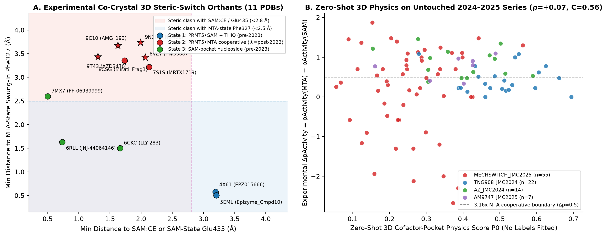
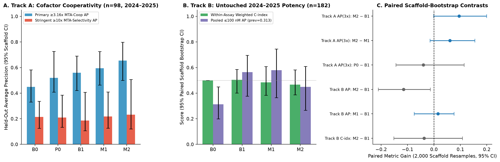

# PRMT5 v2 — 3D Cofactor-State Pocket Physics & Cross-Document Potency Benchmark

[English Report](reports/RESULTS.md) · [中文报告](reports/RESULTS.zh-CN.md) · [中文 README](README.zh-CN.md) · [Protocol](docs/PROTOCOL.md) · [Data Card](docs/DATA_CARD.md) · [Model Card](docs/MODEL_CARD.md)

**PRMT5 v2** is a zero-leakage, cryptographically sealed structural biophysics and machine learning benchmark resolving why 2D non-chiral transfer collapsed in `prmt5-sourcebench` (v1) and advancing evaluation to the modern precision-oncology frontier: **2nd-generation MTA-cooperative `PRMT5•MTA` selective inhibitors for `MTAP`-deleted cancers** (`MRTX1719`, `TNG908`, `TNG462`, `AMG 193`, `AZD3470`).



---

## Executive Findings

1. **Three Mutually Exclusive 3D Crystallographic Steric Orthants Govern PRMT5 Mechanism:** Superimposing 13 experimental human PRMT5 co-crystal structures (`331` catalytic-domain $C_\alpha$ atoms, RMSD `0.41–0.77 Å`) onto `PDB 4X61` proves that:
   - **State 1 (`PRMT5•SAM` + THIQ, e.g., `4X61` `EPZ015666`, `5EML`):** Avoids `SAM:CE`/`Glu435` (`>3.19 Å`) while colliding head-on (`0.51–0.58 Å`) with `Phe327`, which swings ~4.5 Å into the substrate channel when `SAM`'s homocysteine tail is absent in `PRMT5•MTA`.
   - **State 2 (`PRMT5•MTA` cooperative, e.g., `7S1S` `MRTX1719`, `8CSG`, `8VEY` `TNG908`, `9C10` `AMG 193`, `9N3R` `TNG462`, `9T43` `AZD3470`):** Stacks cleanly against swung-in `Phe327` (`3.22–3.74 Å`) while colliding directly (`1.30–2.17 Å`) with `SAM:CE` and SAM-locked `Glu435` in `PRMT5•SAM`.
   - **State 3 (`PRMT5` SAM-pocket nucleosides, e.g., `6CKC` `LLY-283`, `7MX7` `PF-06939999`, `6RLL`):** Occupies both cofactor and gatekeeper volumes (`0.50–1.66 Å` to `SAM:CE`; `1.50–2.60 Å` to `Phe327`).
2. **Track A (`PRMT5•MTA` vs `PRMT5•SAM` Cofactor Cooperativity on `98` Untouched `2024–2025` *J. Med. Chem.* Paired Compounds):** Adding pre-2023 3D multi-state crystal pocket physics (`M2`) delivers monotonic improvements across every tier (`B0 = 0.4490` < `P0 = 0.5198` < `B1 = 0.5600` < `M1 = 0.5951` < **`M2 = 0.6552`** primary AP; `Top-20` precision **`80.0%`** [`16/20`]). On continuous $\Delta\text{pActivity}$ selectivity concordance (`3,421` pairs), `M2` reaches **`C-index = 0.6390`** vs `B1 = 0.5159` (**paired scaffold bootstrap `+0.1231`, 95% CI `[+0.0462, +0.2125]`, `p < 0.001`**) and `ROC-AUC = 0.6768` vs `0.5553` (**`+0.1214`, `p = 0.033`**). Even pure zero-shot 3D crystal physics (`P0`, using **zero** bioactivity labels) achieves `AP = 0.5198` and `C-index = 0.5554` (exceeding supervised achiral 2D `B1`'s `0.5159`).
3. **Track B (Cross-Document Potency on `182` Untouched `2024–2025` Peer-Reviewed Compounds) Exposes Both Gains and True Static-Docking Boundaries:** Chiral pairwise ranking (`M1`) achieves the strongest pooled enrichment (**`AP = 0.5791`** vs `0.3132` prevalence; **`20/25` Top-25 hits**, `2.55x` enrichment vs `B1 = 0.5638`), while `M2` (`Pooled AP = 0.4488`, `Within-Assay C-index = 0.4668`) excels on chiral ring-opened nucleosides (`CHEMBL5544428`: **`M2 AP = 0.7181` vs `B1 = 0.3808`**, Spearman $\rho = +0.5230$ vs $-0.0236$) and dihydroisoquinolinones (`CHEMBL6090539`: **`M2 AP = 0.6440` vs `B1 = 0.5904`**), but degrades on the `PRMT5•SAM` counter-screen of rationally MTA-switched THIQ analogues (`CHEMBL6157149`) where rigid docking penalizes induced-fit rearrangements and where potency loss is driven by deliberate cofactor-mechanism switching — confirming why **Track A and Track B must be deployed together**.



---

## Zero-Leakage Cohort Summary

> **Sacred Rule Enforced:** v1's frozen `246`-compound SK test set (`CHEMBL5737316`, family `75338422`) is strictly quarantined (`0` overlap in `canonical_smiles`, `nonisomeric_smiles`, `scaffold_group`, or `source_family`; verified in `manifests/v1_sk_quarantine.json`). Across all `(train, validation, test)` pairs in both tracks, overlap is **`0`** on all four axes, and all post-2023 PDB structures (`8VEO`, `8VEY`, `9C10`, `9N3R`, `9T43`) are excluded from featurization and docking.

| Benchmark Track | Train (`≤2021`) | Validation (`2019–2022`) | Held-Out Test (`2024–2025`) | Primary Target |
|---|---|---|---|---|
| **Track A: Cofactor Cooperativity (`PRMT5•MTA` vs `PRMT5•SAM`)** | `430` parents / `159` scaffolds / `5` families | `88` parents / `55` scaffolds / `4` families | **`98` parents** (`100%` paired) / `49` scaffolds / `4` *J. Med. Chem.* studies | `y_coop_3x` ($\Delta\text{pActivity} \ge 0.5$, `44.9%` pos) & continuous $\Delta\text{pActivity}$ |
| **Track B: Cross-Document Biochemical Potency** | `818` parents / `361` scaffolds / `5` families | `261` parents / `119` scaffolds / `4` families | **`182` parents** / `75` scaffolds / `5` journal assays | `IC50`/`Ki ≤ 100 nM` (`31.3%` pos) & within-assay $C$-index |

---

## Primary Held-Out Results (2,000 Paired Scaffold Bootstrap 95% CIs)

### Track A — Cofactor-Cooperativity & Selectivity (`n = 98` Paired `2024–2025` Compounds)

| Tier | Description | Primary `y_coop_3x` AP (95% CI) | `ROC-AUC` (95% CI) | Top-20 Hits (`EF`) | Stringent `10x` AP | $\Delta\text{pActivity}$ $C$-index (95% CI) |
|---|---|---:|---:|---:|---:|---:|
| **`B0`** | Constant prevalence reference | `0.4490` `[0.3305, 0.5817]` | `0.5000` | `8.98 exp` (`1.00x`) | `0.2143` | `0.5000` |
| **`P0`** | Zero-shot 3D crystal pocket physics (no labels) | `0.5198` `[0.4080, 0.7267]` | `0.5884` `[0.4465, 0.7124]` | `11` (`1.23x`) | `0.2095` | `0.5554` `[0.4310, 0.6545]` |
| **`B1`** | v1-style non-chiral 2D Morgan (`C=1.0`) | `0.5600` `[0.4208, 0.6901]` | `0.5553` `[0.4051, 0.6825]` | `14` (`1.56x`) | `0.1862` | `0.5159` `[0.3853, 0.6152]` |
| **`M1`** | Chiral 2D + physicochemical ensemble | `0.5951` `[0.4636, 0.7251]` | `0.6582` `[0.5165, 0.7607]` | `13` (`1.45x`) | `0.2172` | `0.6194` `[0.4870, 0.7103]` |
| **`M2`** | **Chiral 2D + 3D cofactor-pocket physics hybrid** | **`0.6552`** `[0.4992, 0.7976]` | **`0.6768`** `[0.5169, 0.7921]` | **`16` (`1.78x`)** | **`0.2319`** | **`0.6390`** `[0.5130, 0.7326]` |

### Track B — Untouched `2024–2025` Biochemical Potency (`n = 182` Compounds)

| Tier | Description | Pooled `≤100 nM` AP (95% CI) | Strict `≤100 nM` vs `>1 µM` AP | Within-Assay $C$-index | Top-25 Hits (`EF`) | Sensitivity at Locked Thr |
|---|---|---:|---:|---:|---:|---:|
| **`B0`** | Constant prevalence reference | `0.3132` `[0.1991, 0.4487]` | `0.3958` | `0.5000` | `7.83 exp` (`1.00x`) | `0.0000` |
| **`B1`** | v1-style uncalibrated achiral 2D | `0.5638` `[0.3759, 0.6960]` | **`0.7533`** | **`0.5043`** | `19` (`2.43x`) | `0.5439` |
| **`M1`** | **Chiral 2D + within-assay `XGBRanker`** | **`0.5791`** `[0.3641, 0.7456]` | `0.6848` | `0.4843` | **`20` (`2.55x`)** | `0.5789` |
| **`M2`** | Chiral 2D + 3D multi-state physics + ranker | `0.4488` `[0.2661, 0.6084]` | `0.5426` | `0.4668` | `12` (`1.53x`) | **`0.8947`** |

---

## Reproducibility & Sealed 4-Commit Chain

Replay all locked metrics, 2,000 paired scaffold resamples, and contract tests entirely on CPU (`≤8` threads):

```bash
cd /home/seedna2/projects/prmt5-v2
source .venv/bin/activate
python scripts/evaluate_locked.py --root . --output-dir outputs/replay_check
pytest -v tests/test_prmt5_v2.py
```

## Licensing & Attribution

- **Code & Documentation:** [MIT License](LICENSE).
- **Bioactivity Data (`ChEMBL_37` & Patent Crosswalks):** [CC BY-SA 3.0](https://creativecommons.org/licenses/by-sa/3.0/).
- **Macromolecular Structures:** [RCSB Protein Data Bank](https://www.rcsb.org/pages/usage-policy) (CC0 1.0 Public Domain; see [`.licenses/pdb_database_LICENSE.txt`](.licenses/pdb_database_LICENSE.txt)).
