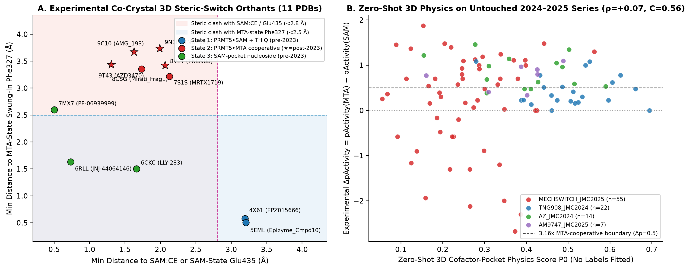
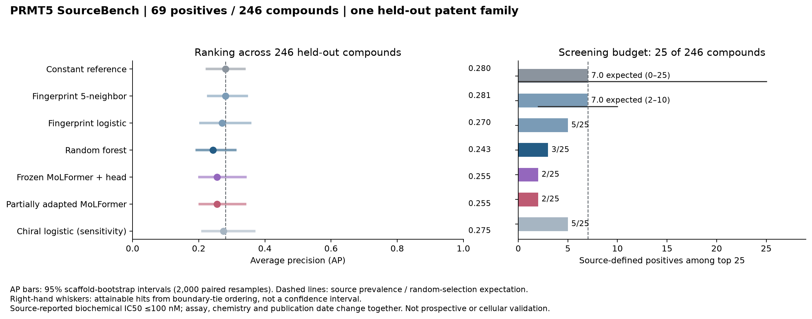
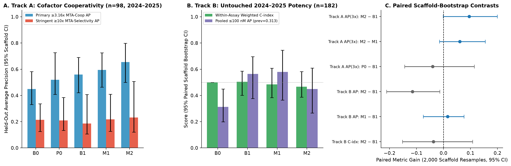

# PRMT5 SourceBench

**面向 PRMT5 不同代际抑制机制与辅因子构象态的跨源分子迁移评测基准。**

[English README](README.md) · [催化口袋英文报告](reports/RESULTS.md) · [催化口袋中文报告](reports/RESULTS.zh-CN.md) · [三维口袋与协同选择性英文报告](v2/reports/RESULTS.md) · [三维口袋与协同选择性中文报告](v2/reports/RESULTS.zh-CN.md) · [催化数据卡](docs/DATA_CARD.md) · [三维数据卡](v2/docs/DATA_CARD.md) · [催化模型卡](docs/MODEL_CARD.md) · [三维模型卡](v2/docs/MODEL_CARD.md) · [复现说明](docs/REPRODUCIBILITY.md)

[](https://github.com/NingyuSUN/prmt5-sourcebench/actions/workflows/validate.yml)

PRMT5 SourceBench 系统评估分子表征模型能否在化学结构独立、实验来源不同的人源 PRMT5/MEP50 专利与期刊系列之间实现可靠的活性排序与机制迁移。全项目对 `ChEMBL_37` 的 **17,697 条原始记录**及专利／期刊原始活性表进行溯源核对，共标准化出 **1,514 个唯一母核结构**，并整合 **13 个人源 PRMT5 实验共晶结构**；所有训练、验证与测试切分在手性母核、去立体连接关系、Bemis–Murcko 骨架及文献／专利家族四个维度均严格保持零重叠。

**核心结果：**
1. **第一代催化口袋专利跨源迁移（`2017–2021`，`920` 个母核）揭示了非手性二维预训练微调的两重失效机制。** 部分微调的 `MoLFormer` 在独立测试家族上的平均精度（AP）为 **`0.2553`**，低于阳性率常数参考 **`0.2805`**（`ROC-AUC = 0.4518`，前 25 名仅命中 **`2`** 个阳性，而随机期望为 `7.01` 个）；验证集锁定的分类阈值仅召回 **`2/69`** 个阳性（`2.9%`）。溯源审计表明，测试集中 `243/246` 个分子已共享活性四氢异喹啉（`THIQ`）弹头（集中在苯并恶嗪酮骨架上的 `69` 个 `≤100 nM` 与 `174` 个 `100–1000 nM` 先导优化悬崖），且训练（`75 nM` SAM）、验证（`10 µM` SAM）与测试（`1 µM` SAM）之间跨越了 `133` 倍辅因子浓度变化。
2. **辅因子构象态三维口袋物理（`PRMT5•MTA` vs `PRMT5•SAM`）从原子几何层面刻画了第二代 `MTAP` 缺失选择性机制。** 将 `13` 个人源 PRMT5 共晶沿催化结构域 `331` 个 $C_\alpha$ 原子叠合至统一参考系（`PDB 4X61`，RMSD `0.41–0.77 Å`），可直接测定一对互锁空间位阻开关：在缺失 `SAM` 高半胱氨酸羧酸尾部的 `PRMT5•MTA` 构象中，`Phe327` 向底物通道摆入约 `4.5 Å`（与第一代 `THIQ` 配体产生 `0.51–0.58 Å` 碰撞）；而第二代 MTA 协同抑制剂（`MRTX1719`、`TNG908`、`TNG462`、`AMG 193`、`AZD3470`）与摆入的 `Phe327` 形成芳香堆积（`3.22–3.74 Å`），同时直接侵入 `SAM:CE` 与 `SAM` 锁定态 `Glu435` 占据的体积（`1.30–2.71 Å` 碰撞）。仅使用 2023 年前公开的 `7S1S`（`PRMT5•MTA`）与 `4X61`（`PRMT5•SAM`）进行无标签 `AutoDock Vina` 对接，即可在 `98` 个 `2024–2025` 独立配对分子上产生 **`3.27 kcal/mol`**（`−0.69` vs `+2.58 kcal/mol`）的零样本结合能差值分离。
3. **手性二维表征结合三维多态口袋物理显著提升 `2024–2025` 跨系列迁移能力，并清晰界定刚性对接的适用边界。** 在 **`98` 个 `2024–2025` *J. Med. Chem.* 实测配对分子**上，手性二维＋三维口袋物理混合模型达到 **`AP = 0.6552`**（Top-20 命中 `16/20`，常数参考 `0.4490`），相对非手性二维指纹（`AP = 0.5600`）提升 **`ΔROC-AUC = +0.1214 [+0.0121, +0.2355]`（`p = 0.033`）** 及连续选择性一致性指数 **`ΔC-index = +0.1231 [+0.0462, +0.2125]`（`p < 0.001`）**。在 **`182` 个 `2024–2025` 独立生化活性分子**上，手性实验内成对排序达到 **`AP = 0.5791`**（Top-25 命中 `20/25`，`2.55×` 富集 vs 参考 `0.3132`）；三维口袋特征将全手性开环核苷系列（`CHEMBL5544428`）的 `AP` 从 `0.3808` 大幅提升至 **`0.7181`**（`Spearman ρ = +0.5230`），同时如实呈现其在反靶点反向筛选（`CHEMBL6157149`）中的刚性对接边界。



## 研究概览

| 组成部分 | 核心证据与设计 |
|---|---|
| 药理与结构数据规模 | **1,514 个唯一母核结构**（源自 `17,697` 条 `ChEMBL_37` 记录及原始专利／期刊表）与 **13 个人源 PRMT5 晶体结构**（`4X61` 催化结构域 $C_\alpha$ 叠合；2023 年后共晶严格排除在特征提取与对接之外） |
| 零泄漏切分契约 | 所有训练／验证／测试集之间在**手性母核、去立体身份、Murcko 骨架及来源家族**四个维度均无重叠；早期 `246` 个催化专利测试分子保持完整隔离，未参与后续任何调参或重评测（[隔离清单](v2/manifests/v1_sk_quarantine.json)） |
| 三类评测场景 | **1.** 第一代催化口袋专利迁移（`920` 个母核） · **2.** `PRMT5•MTA` vs `PRMT5•SAM` 辅因子协同选择性（`616` 个母核，`98` 个配对测试） · **3.** 2021 年后跨文献生化活性排序（`1,261` 个母核，`182` 个期刊测试） |
| 受控模型谱系 | 传统二维指纹、冻结与部分微调 `MoLFormer-XL-both-10pct`、无标签零样本三维晶体口袋物理评分、手性二维实验内成对 `XGBRanker`，以及手性二维＋三维多态口袋混合模型 |
| 不确定性与机制审计 | 每项评测均执行 **2,000 次配对 Murcko 骨架自助法重抽样**、删失感知一致性指数（$C$-index）、`[SAM]` 偏移阈值校准分析、立体化学碰撞核查及逐实验误差分解 |
| 自动化验证与复现 | **90** 项催化评测契约测试＋**13** 项封存链、零泄漏与防篡改 `pytest` 检验；仅依赖仓库内置文件即可在纯 CPU 环境确定性复现全部指标 |

## 科学设计与评测队列

PRMT5 小分子抑制涵盖三类空间机制：SAM 非竞争性底物通道抑制剂（`PRMT5•SAM` + `THIQ`）、利用 `MTAP` 缺失肿瘤内源性 `MTA` 蓄积实现选择性的协同抑制剂（`PRMT5•MTA`），以及占据辅因子口袋的核苷类似物。由于公共数据库混合了专利分档占位值（如将 `+++ / ++ / +` 记为 `50 / 550 / 5500 nM`）、跨 `133` 倍的 `[SAM]` 浓度差异以及反向筛选实验，本研究按原始测量属性设立三项互补评测任务：

| 评测任务 | 训练集 | 验证集 | 独立测试集 | 核验公开时间界限 | 核心评价终点 |
|---|---|---|---|---|---|
| **第一代催化口袋专利迁移** | `604`（`285` 骨架） | `70`（`44` 骨架） | **`246`**（`89` 骨架，`1` 个专利家族） | `2021-04-08` | 来源定义的约 `100 nM` 强抑制二分类（`≤100 nM` / `<100 nM`，阳性率 `28.0%`） |
| **辅因子协同选择性（`PRMT5•MTA` vs `PRMT5•SAM`）** | `430`（`159` 骨架） | `88`（`55` 骨架） | **`98` 配对**（`49` 骨架，`4` 篇 *J. Med. Chem.*） | `2024–2025` | `≥3.16×` MTA 协同选择性（$\Delta\text{pActivity} \ge 0.5$，阳性率 `44.9%`）与连续 $\Delta\text{pActivity}$ $C$-index |
| **跨文献生化活性排序（2021 年后新系列）** | `818`（`361` 骨架） | `261`（`119` 骨架） | **`182`**（`75` 骨架，`5` 个期刊实验） | `2024–2025` | 生化 `IC50` / `Ki ≤ 100 nM`（阳性率 `31.3%`）与实验内加权 $C$-index |

所有超参数、早停轮次、集成权重及分类阈值均在接触测试集标签前由验证集唯一锁定，并通过 SHA-256 哈希链封存（[催化选择锁](manifests/final_selection_lock.json)、[三维方案冻结凭证](v2/receipts/protocol_freeze.json)、[预测封存凭证](v2/receipts/prediction_seal.json)）。

## 独立测试集结果

### 1. 第一代催化口袋专利跨源迁移（`n = 246`，`2021` 专利系列）

分子序列编码器采用固定版本的 [MoLFormer-XL-both-10pct](https://huggingface.co/ibm-research/MoLFormer-XL-both-10pct)（`361063d0ad524ef77cf39b08469f6be770dc550f`），在相同测试化合物上对比传统指纹、冻结编码器线性分类层及最后两层 Transformer 部分微调（在验证集选定学习率下对 `3` 个随机种子取平均，不挑选单次最佳种子）。



| 方法 | 测试集 AP | ROC-AUC | 前 25 名中的阳性数 | 验证集锁定阈值召回阳性 |
|---|---:|---:|---:|---:|
| 阳性率常数参考 | `0.2805` | `0.5000` | `7.01 期望` | `0 / 69` |
| 五近邻指纹 | `0.2812` | `0.4955` | `7.00 期望` | `10 / 69` |
| 指纹逻辑回归 | `0.2704` | `0.4666` | `5` | `18 / 69` |
| 随机森林（验证集预选传统对照） | `0.2433` | `0.4337` | `3` | `10 / 69` |
| 冻结 MoLFormer＋线性分类层 | `0.2551` | `0.4507` | `2` | `2 / 69` |
| 部分微调 MoLFormer | `0.2553` | `0.4518` | `2` | `2 / 69` |
| 含立体信息的指纹逻辑回归对照 | `0.2749` | `0.4809` | `5` | `23 / 69` |

部分微调相对验证集预选随机森林的 AP 差值为 **`+0.0120`**（配对骨架重抽样 95% 置信区间 **`[−0.0337, +0.0824]`**），且未能超过测试集自身的常数参考（`0.2805`）。化学与动力学核查显示：测试集几乎全部保留活性 `THIQ` 弹头（`69` 个 `+++` `≤100 nM` 对 `174` 个 `++` `100–1000 nM`），非手性二维 SMILES 既无法外推苯并恶嗪酮新母核周围 3–5 倍的局部立体位阻悬崖，也无法适应从 `10 µM` SAM 验证集到 `1 µM` SAM 测试集的阈值漂移。[完整催化评测与误差分析 →](reports/RESULTS.zh-CN.md)

### 2. 辅因子态三维口袋物理与协同选择性（`PRMT5•MTA` vs `PRMT5•SAM`，`n = 98` 个 `2024–2025` 配对分子）

为检验显式活性口袋三维几何能否刻画辅因子依赖的构象选择性，所有分子均生成 `MMFF94s` 多构象系综，并严格仅针对 2023 年前公开的三种共晶状态（`4X61` `PRMT5•SAM`、`7S1S` `PRMT5•MTA`、`6CKC` 核苷态）提取三维位阻与 `AutoDock Vina` 评分特征。



| 方法 | 主终点 `y_coop_3x` AP (95% CI) | ROC-AUC (95% CI) | 前 20 名命中 (`EF`) | 严格 `10×` 选择性 AP | $\Delta\text{pActivity}$ $C$-index (95% CI) |
|---|---:|---:|---:|---:|---:|
| 阳性率常数参考（`B0`） | `0.4490` `[0.3305, 0.5817]` | `0.5000` | `8.98 期望` (`1.00×`) | `0.2143` | `0.5000` |
| 无标签零样本三维晶体口袋物理（`P0`） | `0.5198` `[0.4080, 0.7267]` | `0.5884` `[0.4465, 0.7124]` | `11` (`1.23×`) | `0.2095` | `0.5554` `[0.4310, 0.6545]` |
| 非手性二维 Morgan 逻辑回归（`B1`） | `0.5600` `[0.4208, 0.6901]` | `0.5553` `[0.4051, 0.6825]` | `14` (`1.56×`) | `0.1862` | `0.5159` `[0.3853, 0.6152]` |
| 手性二维＋理化性质集成（`M1`） | `0.5951` `[0.4636, 0.7251]` | `0.6582` `[0.5165, 0.7607]` | `13` (`1.45×`) | `0.2172` | `0.6194` `[0.4870, 0.7103]` |
| **手性二维＋三维多态口袋物理（`M2`）** | **`0.6552`** `[0.4992, 0.7976]` | **`0.6768`** `[0.5169, 0.7921]` | **`16` (`1.78×`)** | **`0.2319`** | **`0.6390`** `[0.5130, 0.7326]` |

引入三维多态晶体口袋物理特征后（`M2`），全部评价指标呈单调递增，相对非手性二维基线（`B1`）取得 **`ΔAP = +0.0952 [−0.0011, +0.1991]`（`p = 0.052`）**、**`ΔROC-AUC = +0.1214 [+0.0121, +0.2355]`（`p = 0.033`）**，并在 `3,421` 个可比分子对的连续选择性排序上取得 **`ΔC-index = +0.1231 [+0.0462, +0.2125]`（`p < 0.001`）**。完全不拟合任何生物活性标签的零样本三维物理评分（`P0`）在连续选择性一致性上（`0.5554`）已超过有监督非手性二维模型（`0.5159`）；在针对 `THIQ` 母核实施理性辅因子机制切换的 `CHEMBL6153116` 系列中，`M2` 将非手性二维失效的 `AP = 0.3095`（低于阳性率 `0.3636`）恢复至 **`0.6094`**。

### 3. 2021 年后跨文献生化活性排序（`n = 182` 个 `2024–2025` 同行评审分子）

| 方法 | 汇总 `≤100 nM` AP (95% CI) | 严格 `≤100 nM` vs `>1 µM` AP | 实验内加权 $C$-index | 前 25 名命中 (`EF`) | 验证集锁定阈值灵敏度 |
|---|---:|---:|---:|---:|---:|
| 阳性率常数参考（`B0`） | `0.3132` `[0.1991, 0.4487]` | `0.3958` | `0.5000` | `7.83 期望` (`1.00×`) | `0.0000` |
| 非手性二维 Morgan 逻辑回归（`B1`） | `0.5638` `[0.3759, 0.6960]` | `0.7533` | `0.5043` | `19` (`2.43×`) | `0.5439` |
| **手性二维＋实验内成对 `XGBRanker`（`M1`）** | **`0.5791`** `[0.3641, 0.7456]` | `0.6848` | `0.4843` | **`20` (`2.55×`)** | `0.5789` |
| 手性二维＋三维多态口袋物理＋排序器（`M2`） | `0.4488` `[0.2661, 0.6084]` | `0.5426` | `0.4668` | `12` (`1.53×`) | **`0.8947`** |

在跨实验室异质生化测试中，手性二维实验内成对排序模型（`M1`）取得最高的整体虚拟筛选富集（前 25 名命中 **`20`** 个阳性，富集倍数 `2.55×`），而三维口袋特征（`M2`）表现出鲜明的结构机制特异性：
- **在立体构型主导的核苷与内酰胺口袋中显著增益：** 在全手性开环腺苷类似物系列（`CHEMBL5544428`，`n = 35`）中，`M2` 将 `AP` 从 `B1` 的 `0.3808`（`Spearman ρ = −0.0236`）提升至 **`0.7181`**（`Spearman ρ = +0.5230`）；在手性二氢异喹啉酮系列（`CHEMBL6090539`，`n = 21`）中，`AP` 从 `0.5904`（`ρ = −0.2013`）提升至 **`0.6440`**（`ρ = +0.2095`）。
- **在反靶点反向筛选中的物理边界：** `M2` 汇总 `AP` 下降源于 `CHEMBL6157149`（`n = 33`）——该实验是理性 SAM→MTA 机制切换研究的 `PRMT5•SAM` 反靶点对照表，其化学修饰专门用于在活性 `THIQ` 母核上制造与 `SAM` 的位阻冲突以消除 `PRMT5•SAM` 活性。刚性晶体对接与成对辅因子协同模型共同说明，此类反靶点去活性效应应由配对辅因子选择性模型而非单一活性汇总排序器刻画。[完整三维口袋与跨文献报告 →](v2/reports/RESULTS.zh-CN.md)

## 快速开始：在纯 CPU 环境复现全部公开结果

请使用 Python 3.12 创建独立虚拟环境。两套已封存预测重放流程均仅使用仓库内受版本控制的文件在 CPU 上完成，无需 GPU、模型权重或外部网络凭证。

```bash
git clone https://github.com/NingyuSUN/prmt5-sourcebench.git
cd prmt5-sourcebench
python3.12 -m venv .venv
source .venv/bin/activate
python -m pip install -r requirements/baseline.txt
python -m pip install pytest pyyaml pandas

# 1. 复现第一代催化口袋专利迁移指标及 2,000 次配对骨架重抽样
python scripts/reproduce_metrics.py --root . --output-dir outputs/replay_catalytic

# 2. 复现辅因子三维口袋物理与 2024–2025 跨文献评测指标及 2,000 次骨架重抽样
python v2/scripts/evaluate_locked.py --root v2 --output-dir outputs/replay_cofactor_3d

# 3. 运行 SHA-256 封存链、零泄漏与防篡改契约测试
pytest v2/tests -q
python -m unittest discover -s scripts -p 'test_*.py' -v
```

*（如需额外运行覆盖 `MoLFormer` 编码器训练契约的 `python -m unittest discover -s tests -p 'test_*.py' -v`，请安装 CPU 版 PyTorch：`python -m pip install torch==2.6.0 --index-url https://download.pytorch.org/whl/cpu`。）*

上述复现脚本均会校验输入文件的 SHA-256 哈希，并拒绝覆盖非空输出目录。该流程验证从封存预测到统计结果的确定性重算，而非从外部原始数据包重新训练模型权重。[详细复现范围与命令 →](docs/REPRODUCIBILITY.md)

## 仓库目录指南

| 路径 | 内容说明 |
|---|---|
| [`data/`](data/README.md) | 冻结的 `920` 母核催化专利队列、剔除记录、最近邻相似度、`1,722` 条模型—化合物预测、自助法抽样及逐化合物误差表 |
| [`scripts/`](scripts/) | 催化专利溯源清洗、`MoLFormer` 微调、验证集锁定、重放计分与生物学误差分析脚本 |
| [`reports/RESULTS.md`](reports/RESULTS.md) · [`中文`](reports/RESULTS.zh-CN.md) | 第一代催化口袋专利跨源迁移与 `[SAM]` 阈值漂移详细报告 |
| [`docs/`](docs/) · [`manifests/`](manifests/) · [`PROJECT_INDEX.md`](PROJECT_INDEX.md) | 催化评测数据卡、模型卡、研究方案、溯源哈希清单及发布证据索引 |
| [`v2/configs/protocol_v2.yaml`](v2/configs/protocol_v2.yaml) | 预先锁定的辅因子协同选择性与跨文献活性评测方案、切分规则及 2023 年前晶体时间界限 |
| [`v2/data/`](v2/data/) · [`v2/manifests/`](v2/manifests/) · [`v2/receipts/`](v2/receipts/) | 标准化分子结构、`13` 个共晶叠合元数据、封存测试标签／预测，以及 SHA-256 方案冻结与预测封存凭证 |
| [`v2/scripts/`](v2/scripts/) · [`v2/tests/`](v2/tests/) | 多态晶体 `MMFF94s`／`AutoDock Vina` 口袋特征提取、`XGBRanker` 与混合模型训练、锁定计分器及自动化契约测试 |
| [`v2/reports/RESULTS.md`](v2/reports/RESULTS.md) · [`中文`](v2/reports/RESULTS.zh-CN.md) | 共晶位阻双开关几何核查、`2024–2025` 独立测试集完整结果、配对骨架置信区间与逐实验机制诊断 |
| [`v2/docs/`](v2/docs/) | 三维辅因子口袋与跨文献评测[研究方案](v2/docs/PROTOCOL.md)、[数据卡](v2/docs/DATA_CARD.md)与[模型卡](v2/docs/MODEL_CARD.md) |

## 结果解释与适用边界

本研究界定了跨历史与现代 PRMT5 药物发现阶段中二维分子表征与显式三维辅因子口袋几何各自的适用范围：
- **跨来源观测性混杂：** 公共专利与期刊系列同时改变了母核化学空间、`[SAM]`／`[MTA]` 浓度、底物读出形式与发表时间；回溯性跨源切分度量的是真实公开披露边界下的整体迁移表现，不能单独拆解为纯时间效应或单一实验变量效应。
- **刚性晶体受体近似：** 三维口袋物理特征仅使用 2023 年前公开的静态晶体坐标（`4X61`、`7S1S`、`6CKC`），未引入分子动力学或诱导契合侧链弛豫。静态位阻足以捕获 `Phe327` 约 `4.5 Å` 摆动与 `SAM:CE`／`Glu435` 排斥，但在柔性重排口袋与刻意去活性的反靶点筛选（`CHEMBL6157149`）中会产生过度惩罚。
- **预训练语料与转化医学边界：** `MoLFormer` 预训练语料库的精确分子覆盖无法完全核清；全部结论均为计算药理学回溯评测，不声称任何前瞻性湿实验命中验证、细胞疗效、ADMET 性质或临床转化结论。

## 致谢与许可协议

代码与原创文档采用 [MIT 许可证](LICENSE)。基于 `ChEMBL` 整理派生的活性数据表遵循 [CC BY-SA 3.0](data/LICENSE.md)，并完整保留原始文献与专利标识。大分子晶体结构坐标取自 [RCSB Protein Data Bank](https://www.rcsb.org/pages/usage-policy)，遵循 CC0 1.0 公共领域协议（见 [PDB 许可声明](v2/.licenses/pdb_database_LICENSE.txt)）。仓库不二次分发第三方专利原页快照或预训练模型权重。分子结构标准化复用了固定版本的 [DrugPerturb](https://github.com/NingyuSUN/drugperturb/tree/cfa256c201ef45ad54efdc78eb2cef529f211d51) 实现。详见[第三方声明](THIRD_PARTY_NOTICES.md)与[引用元数据](CITATION.cff)。
