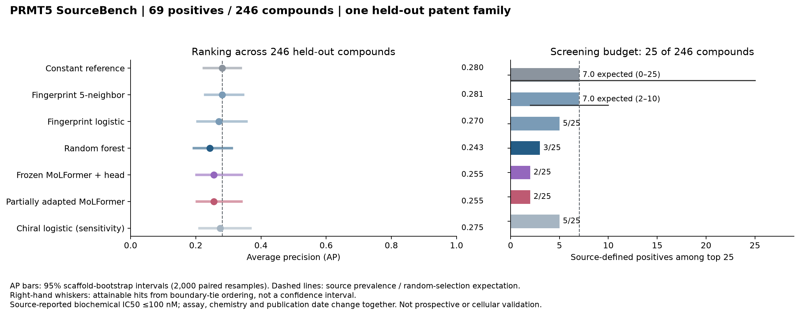

# PRMT5 SourceBench — results and biological interpretation

**Partial adaptation did not establish useful transfer to the held-out PRMT5 patent series.** On 246 test parents (69 source-defined positives), the adapted encoder achieved AP 0.2553, close to frozen features (0.2551), below the constant-prevalence reference (0.2805), and only modestly above the validation-selected random forest (0.2433). Its top 25 contained 2 positives; random selection would contain 7.01 on average. The paired AP difference against random forest was +0.0120, with 95% scaffold-bootstrap interval [−0.0337,+0.0824]. This does not demonstrate an improvement.

## Question, data and experiment

The question was whether a pretrained molecular representation, frozen or partially adapted, transfers source-defined strong-inhibitor ranking across independent PRMT5 series. The original patents frequently report intervals; numerical database surrogates are not precise IC50 measurements. The target is source-defined strong biochemical inhibition around 100 nM: early A bins are <100 nM, while later numeric/interval sources use ≤100 nM. Original boundaries are retained; this is not a uniform potency scale.

The final cohort contains 604 training, 70 validation and 246 test parents, with 164/39/69 positives and 285/44/89 scaffold groups. There is no parent, scaffold, nonisomeric identity or family intersection across splits. Training publications have verified 2017–2018 public-by bounds; validation and test activity tables were public on 2019-09-12 and 2021-04-08. Individual pair-first disclosure is not fully established. See [data card](../docs/DATA_CARD.md) and [family/date ledger](curation/source_family_dates.csv).

Fingerprint/reference baselines used 10 prespecified configurations. A pinned MoLFormer encoder produced 768-dimensional vectors; three training-only scaled logistic heads selected C = 1. Partial adaptation updated the final two blocks (7,093,248 encoder parameters) and a 769-parameter head, while retaining the training scaler, earlier parameters and pretrained random-feature buffers. Six trials covered two learning rates and three seeds, totaling 39 epochs. Learning rate 1e−5 was selected by mean validation AP across all three seeds; final predictions average seeds 17/29/43. No best-seed selection or validation refit was used. [Model card and all trial results](../docs/MODEL_CARD.md).

All configuration, epoch, threshold and comparator decisions used validation only. The persisted model-selection lock preceded both prediction arms; each inference receipt binds the exact code/model/data hashes. A separate final lock verifies that the combined predictions are identical to those arm outputs before scoring labels. Curation had access to public labels: this is an openly curated retrospective benchmark, not a blinded trial.

## Final-test results

AP (average precision) describes how strongly positives concentrate toward the top of a ranked list. It is not prediction accuracy or calibrated hit probability. ROC-AUC describes positive-versus-negative ordering across thresholds. Confusion counts use thresholds selected earlier on validation data: TP=true positive, FN=missed positive, FP=false positive, TN=true negative.

| Method | AP [95% scaffold interval] | ROC-AUC | Positive hits in top 25 | TP / FN / FP / TN |
|---|---:|---:|---:|---:|
| Constant prevalence | 0.2805 [0.2244, 0.3379] | 0.5000 | 7.01 expected [0, 25] | 0 / 69 / 0 / 177 |
| Five-neighbor fingerprint | 0.2812 [0.2285, 0.3453] | 0.4955 | 7.00 expected [2, 10] | 10 / 59 / 23 / 154 |
| Fingerprint logistic | 0.2704 [0.2050, 0.3555] | 0.4666 | 5 | 18 / 51 / 63 / 114 |
| Random forest | 0.2433 [0.1944, 0.3107] | 0.4337 | 3 | 10 / 59 / 39 / 138 |
| Frozen MoLFormer + head | 0.2551 [0.2027, 0.3413] | 0.4507 | 2 | 2 / 67 / 6 / 171 |
| Partially adapted MoLFormer | 0.2553 [0.2032, 0.3407] | 0.4518 | 2 | 2 / 67 / 18 / 159 |
| Chiral logistic sensitivity | 0.2749 [0.2114, 0.3677] | 0.4809 | 5 | 23 / 46 / 66 / 111 |

The intervals use 2,000 paired resamples of the 89 test scaffolds; all 2,000 contained both classes. They are conditional on this single patent family. The classical comparator was random forest selected on validation, not the method with the largest final-test point estimate. No future-family confidence claim is supported.

For tied scores, the table gives expected hits under random ordering within the boundary tie and its attainable range. The constant reference has all 246 scores tied; 7.01 is an expectation, not seven observed hits. The five-neighbor method also has a boundary tie (expected 7, attainable 2–10); its arbitrary ID-ordered shortlist is retained in the machine-readable result. Untied encoder top 25 results are actual 2/25 counts.

## Why the validation result did not carry over

The adapted ensemble's validation AP was 0.7402 (39/70 positives), with 7/7 positives in its top 10% budget. Final-test AP fell to 0.2553 (69/246 positives), with 2/25 in the top 10%. Source prevalence differs, so raw AP values should not be interpreted without those denominators. More importantly, the test ranking was not enriched above its own source-prevalence reference. This is a failed transfer in the observed source, not evidence that the validation result was a prospective success.

At the frozen validation threshold, adaptation detected 2/69 positives (2.9%) and missed 67/69 (97.1%), while flagging 18/177 negatives (10.2%). Frozen features also detected only 2/69, with 6/177 false positives. High specificity therefore coexists with very poor positive recovery; changing the threshold after seeing these results would constitute a new analysis, not improve this locked result.

Selected-seed test APs were 0.25565,0.25569 and 0.25359; sample SD 0.00120. Their mean AP is 0.25498; AP of their mean probabilities is 0.25531. Both are reported, without selecting a favorable seed. Optimization-seed variability is distinct from scaffold-resampling uncertainty.

## Biological and chemical error analysis

**The assay shift is real, but its causal contribution is unmeasured.** Early sources use FlashPlate with SAM 75 nM; Pharmablock uses AlphaLISA with SAM 10 µM; SK uses ELISA with approximately 1 µM SAM and surface-coated H4 substrate. Timing, enzyme concentration and detection also differ. These changes can alter observed potency, but the dataset cannot separate their effects from chemistry or publication source. No inhibitor binding mode, SAM competition or MTA cooperativity is inferred from the model outputs. MTA-dependent Mirati assays were not pooled.

**Failures are not confined to the most distant structures.** In the prespecified chiral-Morgan audit bands, 142 test parents had nearest-training similarity<0.5 (36 positives), and 104 had similarity 0.5–<0.7 (33 positives). Adapted APs were 0.2368 and 0.3042, below the corresponding prevalence references 0.2535 and 0.3173. At the validation threshold, 34/36 and 33/33 positives were missed. No test compound reached 0.7. These are descriptive within-source strata, not independent validation cohorts; the audit fingerprint includes chirality while the primary model inputs do not.

**Stereochemical information loss is insufficient to explain the full failure.** Removing stereochemical markers produces 231 distinct inputs for 246 test parents. Eleven collision groups contain 26 parents; four mixed-label groups contain 10 parents, imposing at least 4 classification errors on any deterministic input-only classifier. Nevertheless, among the 220 parents without a collision, adaptation missed 63/65 positives. The failure is broader than the unavoidable collision bound; this does not rule out additional stereochemical effects or assay noise. The prespecified chiral-logistic sensitivity arm also did not establish useful ranking.

**Original bins remain interpretable only as bins.** The test parents comprise 69 `+++`,174 `++`,2 `+`, and 1 joint `+|++` parent with consistent negative class. The adapted model missed 67/69 `+++` parents and made 18 false positives among 174 `++` parents. Within-bin potency ordering is not measurable from the source. Single-bin AP is left undefined because each bin has only one binary class.

**Physicochemical summaries describe this series; they do not explain binding.** Positive/negative median molecular weights were 477.54/479.62 Da, estimated logP 2.80/2.46, H-bond donors 1/1, acceptors 6/6 and TPSA 65.48/70.08 Ų. Distributions overlap. The two true positives cannot establish a reliable descriptor rule, and no new descriptor model or tuning was introduced. [Complete descriptive outputs](results/biological_analysis.json) preserve subgroup denominators and all model errors. The released error table has 1,722 model–parent rows (7×246), not 1,722 independent compounds.

## Reproduction, evidence and limits

[Final metrics](results/final_metrics.json), [model card](../docs/MODEL_CARD.md), [frozen protocol](../docs/PROTOCOL.md), [source/data card](../docs/DATA_CARD.md), and [reproduction guide](../docs/REPRODUCIBILITY.md) identify the inputs and execution boundaries. The public release includes the unchanged cohort, final predictions and per-compound error table. Original source snapshots and trained checkpoints remain outside the release, with provenance hashes retained. The offline source bundle reconstructs the frozen cohort byte-for-byte; 11 of 15 comparison targets also match exactly, while four documented ordering-only differences preserve scientific content. Two independent archive builds match. Saved-prediction scoring is replayed separately; see the final verification receipt for exact comparisons.

The scope is one biochemical source-shift benchmark. It does not establish prospective activity prediction, cross-laboratory reliability, cellular efficacy, selectivity, ADMET, antibody discovery, or a validated PRMT5 candidate. The modern pretrained model's exact structure-corpus membership is unknown; no PRMT5-label training was identified in the inspected documentation. A model available before the source dates is not claimed. New clean-environment installation and complete live-source acquisition have not been validated.

The study supports a concrete research conclusion: this fixed small-data adaptation strategy did not solve the observed transfer problem. A future hypothesis would require a new protocol and an additional untouched source; this test set must not become an iterative tuning target.
