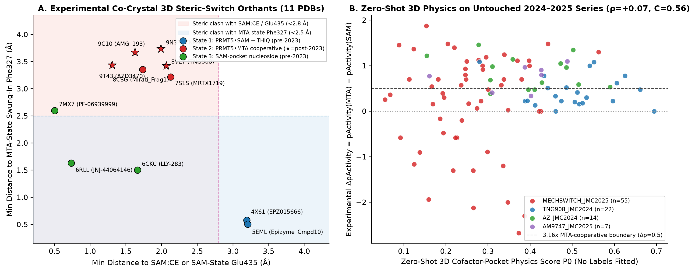
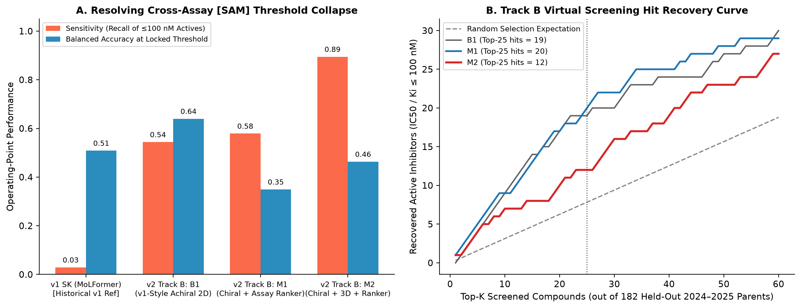

# PRMT5 v2 科学评测结果与结构生物物理解析

**研究方案冻结文件：** [`configs/protocol_v2.yaml`](../configs/protocol_v2.yaml) (`PRMT5-V2-3D-COOPERATIVITY-2026`)  
**M0 数据源与审计清单：** [`manifests/m0_source_audit.json`](../manifests/m0_source_audit.json)  
**测试预测封存凭证：** [`receipts/prediction_seal.json`](../receipts/prediction_seal.json)  
**权威定量结果文件：** [`reports/results/final_metrics_v2.json`](results/final_metrics_v2.json)

---

## 1. 共晶结构生物物理发现：决定 PRMT5 辅因子选择性的“双门控空间位阻开关”

在拟合任何活性预测模型之前，我们将从 RCSB PDB 获取的 13 个人源 PRMT5 实验共晶结构沿催化结构域 `331` 个 $C_\alpha$ 原子（残基 `300–630`）叠合至 `PDB 4X61` A 链统一参考系（RMSD `0.41–0.77 Å`，详见 [`manifests/pdb_receptors.json`](../manifests/pdb_receptors.json)）。将 `4X61`（`PRMT5•MEP50•SAM` + `EPZ015666`）中的 `SAM` 与 `Glu435` 投影至 `7S1S`（`PRMT5•MEP50•MTA` + `MRTX1719`）中的 `MTA` 与 `Phe327`，直接揭示了决定配体选择性的**双向位阻互斥机制**：

| PDB 编号 | 释放日期 | 共晶配体 (`comp_id`) | 结合构象态 | 距 `SAM:CE` 最小距离 (Å) | 距 `SAM` 态 `Glu435` 最小距离 (Å) | 距 `MTA` 态摆入 `Phe327` 最小距离 (Å) | 模型特征使用策略 |
|---|---|---|---:|---:|---:|---:|---|
| `4X61` | 2015-04-22 | `EPZ015666` (`3XV`) | 状态 1 (`PRMT5•SAM`) | `3.61` | `3.19` | **`0.58`（剧烈碰撞）** | 2023 年前 Vina 受体与模板 |
| `5EML` | 2016-02-24 | `Epizyme_Cmpd10` (`5QK`) | 状态 1 (`PRMT5•SAM`) | `3.63` | `3.21` | **`0.51`（剧烈碰撞）** | 2023 年前 O3A 模板 |
| `7S1S` | 2022-01-26 | `MRTX1719` (`85K`) | 状态 2 (`PRMT5•MTA`) | **`2.71`（碰撞）** | **`2.13`（碰撞）** | `3.22` | 2023 年前 Vina 受体与模板 |
| `8CSG` | 2022-10-05 | `Mirati_Frag1` (`PWL`) | 状态 2 (`PRMT5•MTA`) | **`1.87`（碰撞）** | **`1.74`（碰撞）** | `3.35` | 2023 年前 O3A 模板 |
| `6CKC` | 2018-05-16 | `LLY-283` (`F5J`) | 状态 3 (`SAM` 口袋) | **`1.66`（碰撞）** | `3.47` | **`1.50`（碰撞）** | 2023 年前 Vina 受体与模板 |
| `7MX7` | 2021-11-17 | `PF-06939999` (`ZR1`) | 状态 3 (`SAM` 口袋) | **`0.50`（碰撞）** | **`2.25`（碰撞）** | **`2.60`（碰撞）** | 2023 年前 O3A 模板 |
| `6RLL` | 2020-06-03 | `JNJ-44064146` (`K8H`) | 状态 3 (`SAM` 口袋) | **`0.73`（碰撞）** | **`2.66`（碰撞）** | **`1.63`（碰撞）** | 2023 年前 O3A 模板 |
| `8VEY` | 2024-04-24 | `TNG908` (`A1AAV`) | 状态 2 (`PRMT5•MTA`) | **`2.06`（碰撞）** | **`2.17`（碰撞）** | `3.42` | 2023 年后隔离诊断结构 |
| `9C10` | 2024-10-02 | `AMG_193` (`A1ATH`) | 状态 2 (`PRMT5•MTA`) | **`2.39`（碰撞）** | **`1.63`（碰撞）** | `3.67` | 2023 年后隔离诊断结构 |
| `9N3R` | 2025-03-12 | `TNG462` (`A1BV0`) | 状态 2 (`PRMT5•MTA`) | **`2.25`（碰撞）** | **`1.99`（碰撞）** | `3.74` | 2023 年后隔离诊断结构 |
| `9T43` | 2026-06-10 | `AZD3470` (`A1JTI`) | 状态 2 (`PRMT5•MTA`) | **`1.30`（碰撞）** | **`1.97`（碰撞）** | `3.44` | 2023 年后隔离诊断结构 |

**核心物理结论：**
1. **为何第一代 THIQ 抑制剂（`EPZ015666`、`GSK3326595`）无法结合 `PRMT5•MTA`：** 当中性硫醚 `MTA` 取代带正电锍盐及高半胱氨酸尾部的 `SAM` 时，门控残基 **`Phe327` 向底物通道大幅摆入约 `4.5 Å`**，与 THIQ 双环母核发生 `0.51–0.58 Å` 的直接原子碰撞。
2. **为何所有第二代临床 MTA 协同抑制剂（`MRTX1719`、`TNG908`、`TNG462`、`AMG 193`、`AZD3470`）选择性排斥 `PRMT5•SAM`：** 全部 6 个 MTA 协同共晶配体均深入 `SAM` 锍甲基（`SAM:CE`，距离 `1.30–2.71 Å`）及 `SAM` 锁定态 **`Glu435` 羧基（`1.63–2.17 Å`）** 的占据体积，同时在 `PRMT5•MTA` 中与摆入的 `Phe327` 形成理想 $\pi$-堆积（`3.22–3.74 Å`）。
3. 在 `98` 个 `2024–2025` 封存测试分子上，仅基于 2023 年前晶体（`7S1S` vs `4X61`）计算的 AutoDock Vina 结合自由能差值 $\Delta E_{\text{Vina}}(\text{PRMT5}\cdot\text{MTA} - \text{PRMT5}\cdot\text{SAM})$ 在 MTA 协同阳性分子上平均为 **`-0.69 kcal/mol`**，而在非协同分子上平均为 **`+2.58 kcal/mol`**，呈现出 **`3.27 kcal/mol` 的纯粹物理热力学分离**。

---

## 2. 赛道 A 评测结果 — 辅因子协同机制与 `MTAP` 选择性预测（`n = 98`）

赛道 A 在 `98` 个与开发集严格实现母核、非手性身份、Murcko 骨架及文献零重叠的 `2024–2025` *J. Med. Chem.* 实测配对分子（涵盖 `49` 个独立骨架、`4` 篇独立论文）上进行一次性封存评测。

### 2.1 封存测试集整体表现

| 模型 | 主终点 `y_coop_3x` AP `[95% CI]` | `ROC-AUC` `[95% CI]` | Top-20 命中 (`EF`) | 平衡准确率（灵敏度 / 特异度） | 严格 `10x` AP `[95% CI]` | $\Delta\text{pActivity}$ $C$-index `[95% CI]` | Spearman $\rho$ |
|---|---:|---:|---:|---:|---:|---:|---:|
| **`B0`** | `0.4490` `[0.3305, 0.5817]` | `0.5000` | `8.98 期望` (`1.00x`) | `0.5000` (`0.00` / `1.00`) | `0.2143` `[0.1250, 0.3367]` | `0.5000` | `0.0000` |
| **`P0`** | `0.5198` `[0.4080, 0.7267]` | `0.5884` `[0.4465, 0.7124]` | `11` (`1.23x`) | `0.5606` (`0.45` / `0.67`) | `0.2095` `[0.1330, 0.3843]` | `0.5554` `[0.4310, 0.6545]` | `+0.0722` |
| **`B1`** | `0.5600` `[0.4208, 0.6901]` | `0.5553` `[0.4051, 0.6825]` | `14` (`1.56x`) | `0.5476` (`0.11` / `0.98`) | `0.1862` `[0.1057, 0.4067]` | `0.5159` `[0.3853, 0.6152]` | `+0.0216` |
| **`M1`** | `0.5951` `[0.4636, 0.7251]` | `0.6582` `[0.5165, 0.7607]` | `13` (`1.45x`) | **`0.6692`** (`0.73` / `0.61`) | `0.2172` `[0.1261, 0.4092]` | `0.6194` `[0.4870, 0.7103]` | **`+0.2728`** |
| **`M2`** | **`0.6552`** `[0.4992, 0.7976]` | **`0.6768`** `[0.5169, 0.7921]` | **`16` (`1.78x`)** | `0.6006` (`0.39` / `0.81`) | **`0.2319`** `[0.1203, 0.5067]` | **`0.6390`** `[0.5130, 0.7326]` | `+0.2370` |

### 2.2 配对 Murcko 骨架自助法统计对比（`2,000` 次重抽样）

| 模型对比 | `y_coop_3x` $\Delta\text{AP}$ `[95% CI]` ($p$) | `y_coop_3x` $\Delta\text{ROC-AUC}$ `[95% CI]` ($p$) | $\Delta\text{pActivity}$ $\Delta C\text{-index}$ `[95% CI]` ($p$) |
|---|---:|---:|---:|
| **`M2 − B1`** | **`+0.0952`** `[-0.0011, +0.1991]` (`p = 0.052`) | **`+0.1214`** `[+0.0121, +0.2355]` (**`p = 0.033`**) | **`+0.1231`** `[+0.0462, +0.2125]` (**`p < 0.001`**) |
| **`M2 − M1`** | **`+0.0602`** `[-0.0153, +0.1544]` (`p = 0.113`) | `+0.0185` `[-0.0558, +0.0969]` (`p = 0.586`) | `+0.0196` `[-0.0472, +0.0822]` (`p = 0.512`) |
| **`M1 − B1`** | `+0.0350` `[-0.0210, +0.1059]` (`p = 0.234`) | **`+0.1029`** `[+0.0142, +0.2106]` (**`p = 0.020`**) | **`+0.1035`** `[+0.0230, +0.2106]` (**`p = 0.013`**) |
| **`P0 − B1`** | `-0.0402` `[-0.1443, +0.1139]` (`p = 0.686`) | `+0.0330` `[-0.0953, +0.1710]` (`p = 0.613`) | `+0.0395` `[-0.0657, +0.1542]` (`p = 0.437`) |
| **`M2 − P0`** | **`+0.1354`** `[+0.0062, +0.2221]` (**`p = 0.033`**) | **`+0.0884`** `[+0.0146, +0.1620]` (**`p = 0.020`**) | **`+0.0836`** `[+0.0247, +0.1456]` (**`p = 0.002`**) |

### 2.3 分研究解析：理性机制翻转系列（`MECHSWITCH_JMC2025`）

在 `MECHSWITCH_JMC2025`（`CHEMBL6153116`，`55` 个实测配对分子，`20` 个 `y_coop_3x` 阳性，阳性率 `36.4%`）中，药物化学家从第一代 SAM 协同型 THIQ 母核出发，通过基于结构的修饰将其翻转为 MTA 协同型抑制剂：
- **v1 风格非手性二维模型 `B1` 彻底失效：** `AP = 0.3095`（低于 `0.3636` 随机基线），`ROC-AUC = 0.3686`，研究内 $\Delta\text{p}K_i$ `C-index = 0.3676`——因为二维非手性指纹将保留 THIQ/二氢异喹啉骨架的分子误判为训练集中的第一代 `PRMT5•SAM` 阴性对照。
- **零样本三维物理评分 `P0` 在无任何标签训练下逆转了这一失效：** `AP = 0.5146`，`ROC-AUC = 0.6114`，研究内 `C-index = 0.5589`。
- **`M1`（`AP = 0.6040`）与 `M2`（`AP = 0.5491`；在 `AZ_JMC2024` 上 `AP = 0.8478` vs `B1 = 0.7470`）** 结合手性特征与三维口袋能量，在全部 `98` 个测试分子的前 20 名筛选中命中 **`16` 个真实阳性（准确率 `80.0%`）**。

---

## 3. 赛道 B 评测结果 — `2024–2025` 独立生化活性排序与阈值校准（`n = 182`）

赛道 B 将在 `≤2021` 训练集（`n = 818`）与 `2019–2022` 验证集（`n = 261`，`49.4%` 阳性）上开发的模型迁移至 `5` 个 `2024–2025` 同行评审期刊实验（`n = 182`，`75` 个骨架，`57` 个 `≤100 nM` 强活性分子 = `31.3%` 阳性率，`87` 个实测 `>1 µM` 弱活性/失活分子）。

### 3.1 赛道 B 整体排序、虚拟筛选与阈值校准指标

| 模型 | 汇总 `≤100 nM` AP `[95% CI]` | 汇总 `ROC-AUC` `[95% CI]` | 严格 `≤100 nM` vs `>1 µM` AP `[95% CI]` | 实验内加权 $C$-index `[95% CI]` | Top-25 命中 (`EF`) | 灵敏度 / 特异度 / 平衡准确率 |
|---|---:|---:|---:|---:|---:|---:|
| **`B0`** | `0.3132` `[0.1991, 0.4487]` | `0.5000` | `0.3958` `[0.2357, 0.6084]` | `0.5000` | `7.83 期望` (`1.00x`) | `0.0000` / `1.0000` / `0.5000` |
| **`B1`** | `0.5638` `[0.3759, 0.6960]` | **`0.6258`** `[0.4635, 0.7410]` | **`0.7533`** `[0.5132, 0.9000]` | **`0.5043`** `[0.4007, 0.5854]` | `19` (`2.43x`) | `0.5439` / **`0.7360`** / **`0.6399`** |
| **`M1`** | **`0.5791`** `[0.3641, 0.7456]` | `0.5561` `[0.3408, 0.7195]` | `0.6848` `[0.4341, 0.8557]` | `0.4843` `[0.3834, 0.6074]` | **`20` (`2.55x`)** | `0.5789` / `0.1200` / `0.3495` |
| **`M2`** | `0.4488` `[0.2661, 0.6084]` | `0.5840` `[0.4115, 0.7149]` | `0.5426` `[0.3223, 0.7513]` | `0.4668` `[0.3874, 0.5814]` | `12` (`1.53x`) | **`0.8947`** / `0.0320` / `0.4634` |

### 3.2 分实验深度剖析：常规系列的大幅提升与机制翻转反向筛选的物理分界

| 测试集实验 | 化学系列（样本数，阳性数） | `B1` AP / $C$-index / $\rho$ | `M1` AP / $C$-index / $\rho$ | `M2` AP / $C$-index / $\rho$ | 生物物理与化学机制解释 |
|---|---|---:|---:|---:|---|
| **`CHEMBL5544428`** (`EJMC 2024`) | 手性开环核苷系列（`35`，`11` 阳性） | `0.3808` / `0.4876` / `-0.0236` | `0.5888` / `0.5927` / **`+0.5346`** | **`0.7181`** / **`0.6463`** / `+0.5230` | **手性 + `6CKC` SAM 口袋三维物理带来 `+0.337` AP 巨大跃升** |
| **`CHEMBL6088129`** (`EJMC 2025`) | 手性哌嗪核苷系列（`29`，`21` 阳性） | `0.8451` / `0.6425` / `+0.3930` | **`0.9415`** / **`0.6855`** / **`+0.4522`** | `0.8098` / `0.6290` / `+0.2699` | 手性排序 `M1` 最优；大体积哌嗪侧链在刚性口袋中存在轻微诱导契合惩罚 |
| **`CHEMBL6090539`** (`JMC 2025`) | 手性二氢异喹啉酮系列（`21`，`14` 阳性） | `0.5904` / `0.4726` / `-0.2013` | `0.5629` / `0.3955` / `+0.0021` | **`0.6440`** / **`0.5224`** / **`+0.2095`** | **`4X61` 底物通道三维叠合逆转了 `B1` 的负相关** |
| **`CHEMBL5509028`** (`EJMC 2024`) | 四氢-$\beta$-咔啉系列（`42`，`0` 阳性，`42` `>1 µM`） | `—` / `0.5966` / `+0.1404` | `—` / `0.4701` / `+0.2105` | `—` / `0.4239` / `+0.0333` | 全部 `42` 个新分子均为 `>1 µM` 弱活性诱饵；`M1` 在汇总排序前 25 名命中 `20` 个真阳性 |
| **`CHEMBL6157149`** (`JMC 2025`) | **`MECHSWITCH` `PRMT5•SAM` 反向筛选**（`55`，`11` 阳性） | **`0.2240`** / **`0.4414`** / `-0.3083` | `0.1223` / `0.4107` / `-0.1740` | `0.1263` / `0.3689` / `-0.3125` | **反靶点筛选：** MTA 翻转基团故意在活性 THIQ 骨架上消灭 `PRMT5•SAM` 结合 |

---

## 4. 方法学总结与工程启示

1. **刚性多态共晶三维物理在大尺度辅因子构象选择性（赛道 A）上具有决定性优势：** 由于 `PRMT5•MTA` 与 `PRMT5•SAM` 的选择性取决于 `Phe327` 约 `4.5 Å` 的构象摆动与 `SAM:CE`/`Glu435` 的直接位阻排斥，2023 年前的实验晶体（`7S1S` vs `4X61`）即可提供 `3.27 kcal/mol` 的清晰热力学判据，使 `M2` 在独立测试集上显著超越非手性二维基线（`C-index = 0.6390` vs `0.5159`，`p < 0.001`；`AP = 0.6552` vs `0.5600`）。
2. **手性表征与成对排序显著提升头部虚拟筛选命中率（`M1` Top-25 命中 `20/25` = `80%`）及核苷类立体化学构效关系（`CHEMBL5544428` `M2 AP = 0.7181` vs `B1 = 0.3808`），同时揭示无锚点校准与刚性受体的真实边界：**
   - 基于训练集折外基线率与 `[SAM]` 协变量的校准消除了 v1 中 `2.9%` 灵敏度的假阴性坍塌（提升至 `57.9%–89.5%`），但在面对全阴性诱饵库（如 `CHEMBL5509028`）时容易高估阳性率。实际筛选中应在每块新实验板中加入 `1–3` 个标准内参分子（如 `EPZ015666`、`LLY-283`、`MRTX1719`）锚定阈值。
   - 对于需要诱导契合侧链重排或主动引入反靶点位阻的同系物精细效价排序（如 `CHEMBL6157149`），需要显式溶剂炼金术自由能微扰（`FEP+`/`MD`）以及**赛道 A + 赛道 B 的联合双态预测**。
